# HelmX: Edge Motorcycle Crash Detection

[](https://github.com/Usman-Azfar/Crash-Detection/actions/workflows/ci.yml)
[](LICENSE)
[](requirements.txt)

HelmX is a research prototype for detecting motorcycle crash-like motion from
accelerometer and gyroscope data. It combines a supervised classifier with an
autoencoder reconstruction signal, exports the detector to TensorFlow Lite, and
runs the complete alert policy on a Raspberry Pi.

The project covers more than model training: it includes session-safe dataset
splitting, reproducibility manifests, external-domain evaluation, model
ablation studies, live sensor validation, acquisition-integrity monitoring,
and a cancellable GPS/GSM emergency-alert workflow.

> **Safety notice:** HelmX is not a certified medical, automotive, or emergency
> system. It must not be relied on as the sole way to detect a crash or contact
> emergency services.

## Project highlights

- A hybrid Conv1D model processes 1.2-second, six-axis IMU windows at 50 Hz.
- Splits are made at the recording-session level to prevent overlapping windows
  from the same ride leaking across train, validation, and test sets.
- Thresholds are calibrated on validation data and loaded from one artifact by
  both evaluation and deployment code.
- The deployment policy requires three consecutive anomalous windows, applies a
  cooldown, and gives the rider 30 seconds to cancel before an SMS attempt.
- External scooter and bicycle evaluations quantify domain shift instead of
  presenting in-distribution metrics as universal performance.
- Raspberry Pi experiments cover inference, streaming, scheduling, thermal
  behavior, sensor acquisition, trigger logic, and long-duration stability.
- Negative ablation results are retained and reported rather than omitted.

## System architecture

```mermaid
flowchart LR
    IMU[6-axis IMU] --> Guard[Timing and stream guard]
    Guard --> Window[60-sample sliding window]
    Window --> Prep[Gravity correction and features]
    Prep --> Encoder[Shared Conv1D encoder]
    Encoder --> Classifier[Crash probability]
    Encoder --> Decoder[Reconstruction error]
    Classifier --> Fusion[OR decision policy]
    Decoder --> Fusion
    Fusion --> Confirm[3-window confirmation]
    Confirm --> Alarm[Local alarm and 30 s cancellation]
    Alarm -->|not cancelled| Alert[GPS fix and GSM/SMS attempt]
    Alarm -->|cancelled| Resume[Resume monitoring]
    Alert --> Resume
```



The offline and deployment paths intentionally share artifact formats and
decision thresholds. The streaming runtime adds causal gravity correction and
sample-gap protection required for real-time operation.

## Evidence at a glance

The table below is a navigation summary, not a substitute for the full
methodology and limitations in [performance.md](performance.md).

| Evaluation | Selected result | Interpretation |
|---|---:|---|
| Held-out classifier | ROC-AUC 0.95; PR-AUC 0.54 | Strongest in-distribution discriminative branch in the recorded run |
| Five-seed classifier study | ROC-AUC 0.951 ± 0.011; F1 0.317 ± 0.058 | Preferred estimate over any single stochastic training run |
| Unseen DaRUS crash study | Reconstruction ROC-AUC 0.87; classifier ROC-AUC 0.35 | Reconstruction generalized better to the held-out crash mechanism |
| External scooter study | Reconstruction ROC-AUC 0.826; 8/9 crash sessions detected | Useful ranking signal, but deployment thresholds produced substantial domain-shift false alerts |
| Raspberry Pi decision latency | 3.03 ms p99; 11.04 ms maximum | Large compute headroom relative to the sensor window cadence |
| Raspberry Pi live soak | 180 minutes; 33,734 scored windows | No reported deadline misses, sensor failures, reconnects, exceptions, or alerts in that run |

These numbers have important scope limits: the labeled crash set is small,
several abnormal recordings are staged or simulated, no real unstaged motorcycle
crash was collected, and false-alert rates changed materially on an external
vehicle domain. See [performance.md](performance.md) and the
[complete Pi results](piResults/results/COMPLETE_RESULTS.md) before citing them.

## Repository guide

| Path | Purpose |
|---|---|
| [`src/`](src/README.md) | Reusable loading, preprocessing, splitting, modeling, evaluation, and export code |
| [`scripts/`](scripts/README.md) | Training, ablation, evaluation, external-validation, and reproducibility entry points |
| [`deploy/`](deploy/README.md) | Raspberry Pi runtime, configuration, service template, benchmark, and validation suite |
| [`results/`](results/README.md) | Curated offline metrics, figures, experiment outputs, and reproducibility records |
| [`piResults/`](piResults/README.md) | Organized Raspberry Pi experiments, selected evidence, figures, and provenance |
| [`notebooks/`](notebooks/README.md) | Output-free interactive walkthroughs of training and evaluation |
| [`models/`](models/MODEL_CARD.md) | Model card, thresholds, histories, and artifact hashes |
| [`data/`](data/README.md) | Instructions for installing local datasets; raw files are not published |
| [`tests/`](tests) | Fast hardware-independent regression tests |
| [`system_understanding.md`](system_understanding.md) | Detailed technical explanation and design rationale |
| [`performance.md`](performance.md) | Complete offline, external, ablation, and deployment evaluation report |

## Data and artifact policy

The MIT license applies to original HelmX software and documentation. It does
not relicense third-party datasets, participant recordings, or derived model
weights.

Consequently, this public source release intentionally excludes:

- raw training and external-evaluation datasets;
- fitted `.keras`, `.tflite`, and `.npz` artifacts;
- private Raspberry Pi archives and system snapshots;
- temporary research plans and session notes.

Dataset sources and redistribution status are documented in
[DATA_LICENSES.md](DATA_LICENSES.md). The expected local directory layout is in
[data/README.md](data/README.md). Evaluated model hashes remain public in
[`models/ARTIFACT_HASHES.sha256`](models/ARTIFACT_HASHES.sha256) so an authorized
local artifact can be verified without distributing it.

## Quick start

### 1. Create the environment

Python 3.11 is the maintained development version.

```powershell
python -m venv .venv
.venv\Scripts\python -m pip install --upgrade pip
.venv\Scripts\python -m pip install -r requirements.txt
```

On Linux or macOS, use `.venv/bin/python` in place of
`.venv\Scripts\python`.

### 2. Install local data

Obtain the datasets from their authoritative sources and reproduce the layout
described in [data/README.md](data/README.md). Do not place external-validation
datasets inside any of the five training-source directories.

### 3. Train, evaluate, and export

```powershell
.venv\Scripts\python scripts\train.py
.venv\Scripts\python scripts\evaluate_model.py
.venv\Scripts\python scripts\full_metrics.py
.venv\Scripts\python scripts\export_model.py
.venv\Scripts\python scripts\freeze_reproducibility.py
```

Run `freeze_reproducibility.py` last. It records dataset hashes, session split
IDs, seeds, package versions, thresholds, and the Git revision associated with
the run.

The equivalent interactive workflow is available in
[`notebooks/crash-detection-model.ipynb`](notebooks/crash-detection-model.ipynb)
and [`notebooks/model-check.ipynb`](notebooks/model-check.ipynb). The scripts are
the maintained reproducible source of truth.

## Testing and release checks

The default test suite does not require datasets, model binaries, or Raspberry
Pi hardware.

```powershell
.venv\Scripts\python -m unittest discover -s tests -v
.venv\Scripts\python -m compileall -q src scripts deploy tests
.venv\Scripts\python scripts\check_public_release.py
```

The public-release check rejects tracked raw datasets, private archives,
restricted model artifacts, stale nested snapshots, and files close to GitHub's
single-file size limit. The same checks run in GitHub Actions.

## Raspberry Pi deployment

Deployment requires an authorized model export and fitted normalizer matching
the hashes and thresholds used for evaluation.

1. Install [`deploy/requirements.txt`](deploy/requirements.txt) in a Pi virtual
   environment.
2. Place the model, normalizer, and thresholds at the paths configured in
   [`deploy/config.yaml`](deploy/config.yaml).
3. Set the GSM recipient, serial port, GPIO pin, I2C address, and cancellation
   signal path for the actual hardware.
4. Run `python deploy/crash_monitor.py` interactively and validate sensor,
   alarm, cancellation, GPS, and GSM behavior.
5. Install the portable systemd unit with
   `sudo bash deploy/install_service.sh` only after the interactive checks pass.

Hardware wiring, portability controls, and research-runtime instructions are
documented in [deploy/README.md](deploy/README.md). The Pi evidence package also
records tests that were not completed because the required GPS/GSM or electrical
measurement hardware was unavailable.

## Reproducibility and research integrity

- The exact training snapshot is represented by SHA-256 hashes in
  [`results/reproducibility/reproducibility_manifest.json`](results/reproducibility/reproducibility_manifest.json).
- Split assignments are deterministic and operate on whole recording sessions.
- External datasets are evaluation-only and are never silently added to training.
- Reported stochastic training performance includes a five-seed study.
- Superseded, failed, and negative experiments remain documented in the curated
  result packages.
- Assumption-based projections are explicitly separated from measured results.

## Citation

Citation metadata is provided in [CITATION.cff](CITATION.cff). GitHub can use
this file to generate a formatted citation from the repository's **Cite this
repository** menu. Upstream datasets must be cited separately according to
their original terms.

## License

Original HelmX software and documentation are released under the
[MIT License](LICENSE). Dataset, model-weight, and derived-artifact rights are
described separately in [DATA_LICENSES.md](DATA_LICENSES.md) and the
[model card](models/MODEL_CARD.md).
