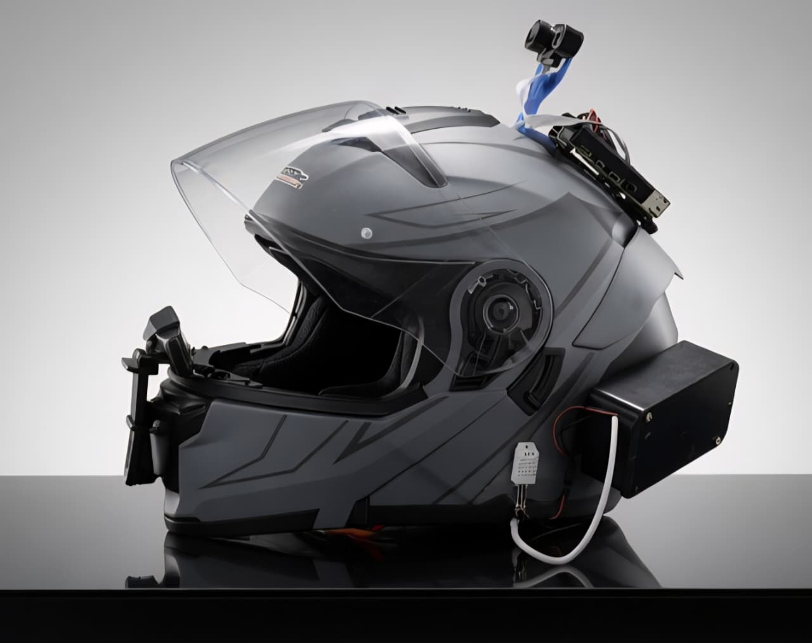
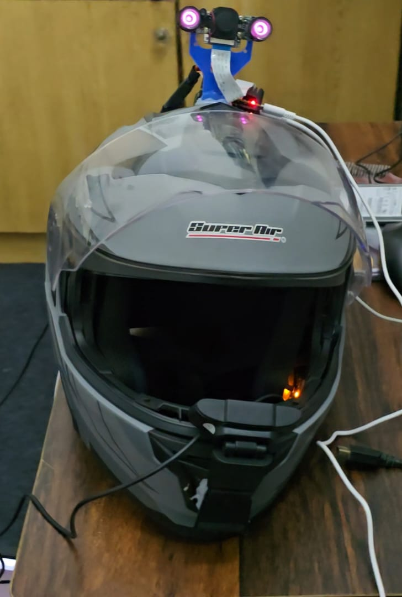
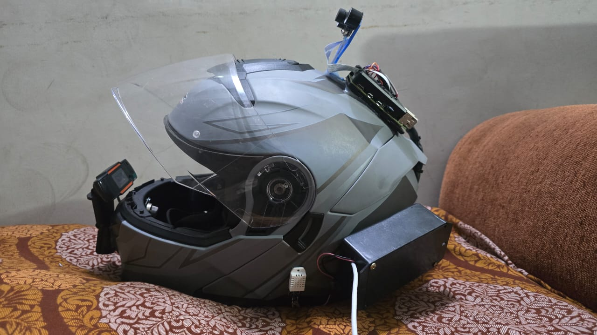
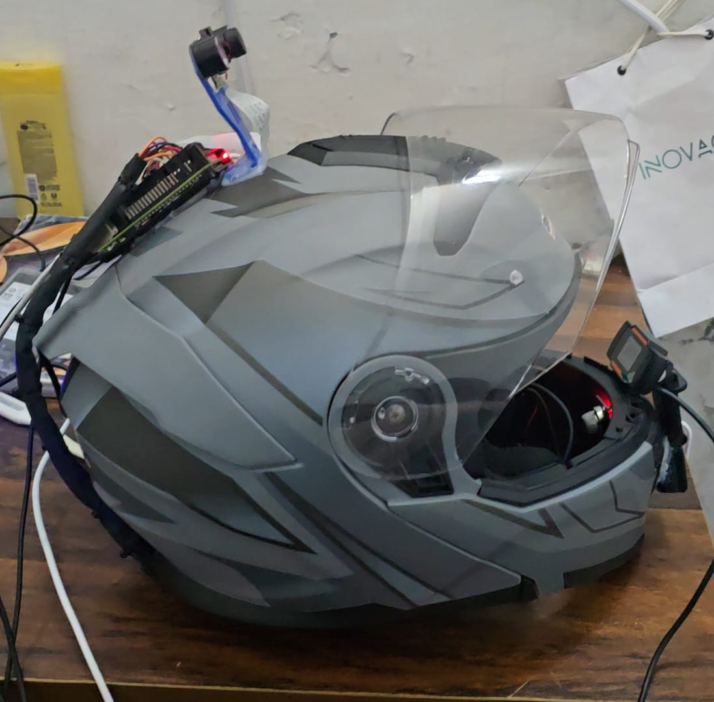
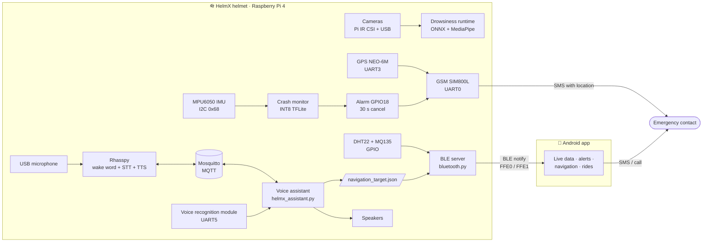
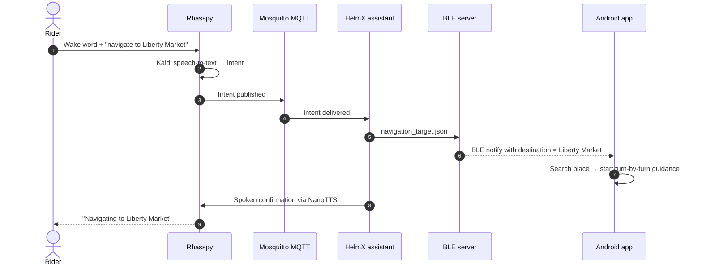
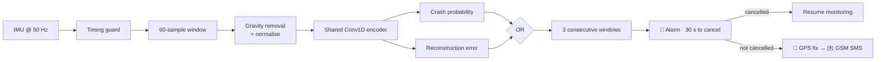

<div align="center">


# HelmX: AI-Powered Smart Helmet

**A smart motorcycle helmet built on a Raspberry Pi 4 that detects crashes and drowsiness, guides the rider with voice and navigation, and senses the air around them. It comes with an Android companion app and a web store.**


[**🌐 Live web demo**](https://helmx-silk.vercel.app/) · [**⬇ Android APK v1.0.0**](https://github.com/Usman-Azfar/HelmX-AI-Powered-Smart-Helmet/releases/tag/android-v1.0.0) · [**🧭 Branch guide**](#repository-map) · [**🔧 Full Pi setup**](docs/hardware/PI_SETUP.md)

<sub>Final Year Project · BS Computer Science · Department of Computer Science, FCIT, University of the Punjab, Lahore · Session 2025–2026</sub>

<br/>



<sub><i>The HelmX working prototype: a modular full-face helmet with a Raspberry Pi 4, cameras, sensors, a cellular module and a battery pack.</i></sub>

</div>

---

## Contents

- [Why HelmX](#why-helmx)
- [What the helmet does](#what-the-helmet-does)
- [The prototype](#the-prototype)
- [Repository map](#repository-map)
- [System architecture](#system-architecture)
- [Helmet hardware](#helmet-hardware)
- [Raspberry Pi platform](#raspberry-pi-platform)
- [On-helmet software](#on-helmet-software)
- [Helmet-to-phone Bluetooth contract](#helmet-to-phone-bluetooth-contract)
- [Crash detection deployment](#crash-detection-deployment)
- [Getting the code](#getting-the-code)
- [Team](#team)
- [Responsible use](#responsible-use)

---

## Why HelmX

Motorcycle riders are among the most vulnerable road users, and help often arrives late after a crash, especially on empty roads or at night. Most smart-helmet products focus on one feature, such as Bluetooth audio, a camera or crash detection, and many are too expensive for everyday riders.

**HelmX puts seven safety and lifestyle features into one low-cost helmet.** All of the AI runs on the helmet itself, on a Raspberry Pi, so the safety features keep working without an internet connection.

## What the helmet does

<table>
  <tr>
    <td width="50%" valign="top">
      <h3>🚨 Crash detection & emergency alert</h3>
      A six-axis IMU streams motion data at 50 Hz to a hybrid Conv1D classifier and autoencoder running on the Pi as an INT8 TensorFlow Lite model. A crash is confirmed only after three anomalous windows in a row. The rider then has <b>30 seconds to cancel</b> before the helmet takes a GPS fix and tries to send an SMS over GSM.
    </td>
    <td width="50%" valign="top">
      <h3>😴 Drowsiness detection</h3>
      A camera watches the rider's eyes, mouth and head pose. A model that uses only current and past frames (MobileNetV3 image features combined with 12 per-rider measurements) estimates whether the rider is <i>alert</i>, has <i>low vigilance</i> or is <i>drowsy</i>. A time-based controller then decides when to sound the alarm.
    </td>
  </tr>
  <tr>
    <td valign="top">
      <h3>🧭 Navigation</h3>
      The rider can ask for a destination by voice, and the helmet passes it to the phone. The Android app then gives turn-by-turn spoken guidance and re-routes when needed. A map of Lahore District is built into the app so navigation still works offline.
    </td>
    <td valign="top">
      <h3>🎙️ Offline voice assistant</h3>
      Rhasspy runs on the helmet with a Porcupine wake word, Kaldi speech recognition and NanoTTS speech output. A dedicated voice recognition module on UART5 adds instant hardware command recognition. Speech is handled on the helmet itself. The rider can ask for sensor readings, a destination, music, a photo or a video clip.
    </td>
  </tr>
  <tr>
    <td valign="top">
      <h3>🌡️ Environmental sensing</h3>
      A DHT22 measures temperature and humidity, and an MQ135 gives an air-quality threshold signal. Readings are sent to the phone over Bluetooth Low Energy every 2.5 seconds.
    </td>
    <td valign="top">
      <h3>📷 Cameras & entertainment</h3>
      The helmet can take photos and 10-second videos and play music through its two speakers. Media is stored in a vault on the helmet.
    </td>
  </tr>
  <tr>
    <td colspan="2" valign="top" align="center">
      <h3>📱 Companion app & web platform</h3>
      An Android app shows live helmet data, crash and drowsiness alerts, navigation and ride analytics. A web platform has a 3D helmet configurator, Stripe checkout and order receipts.
    </td>
  </tr>
</table>

---

## The prototype

<table>
  <tr>
    <td width="33%" align="center"><br/><sub><b>Front</b>: the top camera's infrared illuminators are on, and the chin-mounted module is below the visor</sub></td>
    <td width="33%" align="center"><br/><sub><b>Side</b>: chin-arm USB camera, side-mounted DHT22 sensor and rear enclosure</sub></td>
    <td width="33%" align="center"><br/><sub><b>Rear</b>: Raspberry Pi 4 mounted on the shell, with the GPIO harness running to the sensors</sub></td>
  </tr>
</table>

| Where on the helmet | What is there |
|---|---|
| Top of the shell, on a raised mount | Raspberry Pi IR night-vision camera on a CSI ribbon cable, with two infrared illuminators for low light and night riding |
| Rear of the shell | Raspberry Pi 4 Model B (8 GB), with the GPIO harness running to the sensors |
| Chin bar | USB camera with a built-in microphone (`/dev/video0`), used by the voice assistant and for media capture |
| Left side | DHT22 temperature and humidity sensor |
| Rear-side enclosure | Power pack (2 × 10,000 mAh lithium batteries) and wiring |
| Inside the shell | MPU6050 IMU, MQ135 air-quality sensor, SIM800L GSM, NEO-6M GPS, voice recognition module and 2 speakers |

---

## Repository map

This repository holds the whole HelmX project. **Each part lives on its own branch**, and each branch has its own history, README, build and licence. This `main` branch is the landing page.

| Branch | What it is | Stack | Status |
|---|---|---|---|
| [`main`](https://github.com/Usman-Azfar/HelmX-AI-Powered-Smart-Helmet/tree/main) | **You are here.** Project overview, helmet prototype and the complete Raspberry Pi setup | Markdown | Landing page |
| [`crash-detection`](https://github.com/Usman-Azfar/HelmX-AI-Powered-Smart-Helmet/tree/crash-detection) | IMU crash detection model, the Pi program that runs it, the 30-second cancel and SMS alert, and a large Raspberry Pi evaluation suite | Python 3.11, TensorFlow / TFLite | Research release · MIT |
| [`drowsiness-detection-model`](https://github.com/Usman-Azfar/HelmX-AI-Powered-Smart-Helmet/tree/drowsiness-detection-model) | Camera-based drowsiness model combining image and per-rider features; training, calibration, ONNX export and live camera runtime | Python, PyTorch, ONNX Runtime, MediaPipe | Research prototype · MIT |
| [`android-app`](https://github.com/Usman-Azfar/HelmX-AI-Powered-Smart-Helmet/tree/android-app) | Rider companion app: Bluetooth link to the helmet, safety alerts with automatic SMS and call, turn-by-turn navigation with an offline map, ride analytics | Kotlin, Firebase, MapLibre | [v1.0.0 released](https://github.com/Usman-Azfar/HelmX-AI-Powered-Smart-Helmet/releases/tag/android-v1.0.0) |
| [`web-app`](https://github.com/Usman-Azfar/HelmX-AI-Powered-Smart-Helmet/tree/web-app) | Product website with a 3D helmet configurator, Stripe checkout with server-side pricing, receipt emails and a contact form | Next.js 16, React 19, Three.js, Prisma, PostgreSQL, Stripe | [Live demo](https://helmx-silk.vercel.app/) (Stripe test mode) |

<details>
<summary><b>Branch highlights</b></summary>

**`crash-detection`**
- A hybrid Conv1D model with a shared encoder, a classifier head and an autoencoder head reads 1.2-second, six-axis windows (60 samples at 50 Hz).
- Train, validation and test sets are split by recording session, so overlapping windows from the same ride never leak between sets. The thresholds are calibrated once and shared by the evaluation and deployment code.
- On the Raspberry Pi, the 99th-percentile decision latency was 3.03 ms, and a 180-minute live soak test scored 33,734 windows without errors.
- Ablations, external-domain tests on scooter and bicycle data, and negative results are all kept. Datasets and trained model files are not published; only their hashes are.

**`drowsiness-detection-model`**
- The model uses only current and past frames. A neutral calibration period personalises the eye, mouth and head-pose measurements to each rider.
- A learned gate weights the MobileNetV3 image features against the 12 per-rider features according to how reliable each one is at that moment.
- An elapsed-time alert controller adds persistence, hysteresis, suppression when the input quality is poor, and cooldowns.
- On the development data (UTA-RLDD, 146 videos, 48 subjects), macro-F1 is 0.642 and macro ROC-AUC is 0.779. These results come from development folds, not a final external validation.

**`android-app`**
- Connects to the helmet's Bluetooth service (named `HelmX`) and reconnects automatically if the link drops.
- If the rider doesn't respond to a crash alert within 30 seconds, the app texts the rider's location to their emergency contacts and calls the primary contact.
- Offers MapLibre navigation with Photon place search and OSRM routing, and works offline with the built-in Lahore District map.
- Records rides in a foreground service and stores accounts and rides in Firebase Auth and Firestore.

**`web-app`**
- Uses one shared parts catalog for the user interface and the server, so a modified browser request can't change the price.
- Finalises each payment in one step that can only succeed once, so every order sends exactly one receipt email.
- Loads the 3D configurator only when needed, follows reduced-motion settings and is covered by Vitest tests.

</details>

---

## System architecture



- **Safety-critical paths stay on the helmet.** Crash detection, the alarm and the GSM alert do not depend on the phone or the internet.
- **The phone adds to the helmet.** It shows live data, adds its own alerts and automatic response, and handles navigation and ride history.

---

## Helmet hardware

### Bill of materials

| # | Component | Qty | Interface | Role |
|---:|---|:---:|---|---|
| 1 | **Raspberry Pi 4 Model B** Rev 1.5, 8 GB | 1 | — | Main computer: Cortex-A72 × 4 at 1.8 GHz, boots from SSD |
| 2 | **Raspberry Pi IR night-vision camera** with two IR illuminators | 1 | CSI ribbon | Camera vision in daylight, low light and at night |
| 3 | **USB camera** (icSpring, `32e6:9221`) | 1 | USB, `/dev/video0` | Video and microphone input for the assistant and media |
| 4 | **MPU6050** 6-axis IMU | 1 | I2C1 · `0x68` | Accelerometer and gyroscope for crash detection |
| 5 | **DHT22** | 1 | GPIO BCM22 (pin 15) | Temperature and humidity |
| 6 | **MQ135** | 1 | GPIO BCM17 (pin 11) | Air quality (digital threshold output) |
| 7 | **SIM800L** GSM | 1 | UART0 · pins 8/10 · 9600 baud | Emergency SMS |
| 8 | **NEO-6M** GPS | 1 | UART3 · pins 7/29 · 9600 baud | Location for the emergency SMS |
| 9 | **Voice recognition module** | 1 | UART5 · pins 32/33 · 9600 baud | Hardware voice-command recognition alongside Rhasspy |
| 10 | **Speakers** | 2 | Audio | Voice responses, alerts and music |
| 11 | **Lithium battery**, 10,000 mAh | 2 | — | Portable power |
| 12 | **SanDisk X400 SSD**, 128 GB | 1 | USB 3 · SATA bridge | Root filesystem |

### GPIO and bus map

```text
                    Raspberry Pi 4 · 40-pin header (used pins)
        ┌──────────────────────────────────────────────────────────────┐
        │  pin 3   BCM2  SDA1  ──────┐                                 │
        │  pin 5   BCM3  SCL1  ──────┴──  MPU6050 IMU     (I2C1 0x68)  │
        │  pin 8   BCM14 TXD0  ──────┐                                 │
        │  pin 10  BCM15 RXD0  ──────┴──  SIM800L GSM     (UART0)      │
        │  pin 7   BCM4  TXD3  ──────┐                                 │
        │  pin 29  BCM5  RXD3  ──────┴──  NEO-6M GPS      (UART3)      │
        │  pin 32  BCM12 TXD5  ──────┐                                 │
        │  pin 33  BCM13 RXD5  ──────┴──  Voice module    (UART5)      │
        │  pin 11  BCM17       ─────────  MQ135 digital out            │
        │  pin 12  BCM18       ─────────  Crash alarm output           │
        │  pin 15  BCM22       ─────────  DHT22 data                   │
        └──────────────────────────────────────────────────────────────┘
          CSI ── Pi IR night-vision camera    USB ── webcam + mic, SSD
```

Each serial module's TX goes to the Pi's RX and its RX to the Pi's TX. All grounds are shared.

| Signal | Connection | Device | Status |
|---|---|---|:---:|
| IMU | I2C1 `0x68`, pins 3/5, 100 kHz | `/dev/i2c-1` | ✅ Connected |
| GSM SIM800L | UART0, BCM14/15 (pins 8/10), 9600 baud | `/dev/serial0` | ✅ Connected |
| GPS NEO-6M | UART3, BCM4/5 (pins 7/29), 9600 baud, NMEA | `/dev/ttyAMA3` | ✅ Connected |
| Voice recognition module | UART5, BCM12/13 (pins 32/33), 9600 baud | `/dev/ttyAMA5` | ✅ Connected |
| DHT22 | BCM22, pin 15 | GPIO | ✅ Connected |
| MQ135 | BCM17, pin 11 | GPIO | ✅ Connected |
| Crash alarm | BCM18, pin 12 | GPIO | ✅ Connected |
| IR night-vision camera | CSI | libcamera | ✅ Connected |
| USB camera + microphone | USB | `/dev/video0`, ALSA card 3 | ✅ Connected |

---

## Raspberry Pi platform

| | |
|---|---|
| **Board** | Raspberry Pi 4 Model B Rev 1.5 · 4 × Cortex-A72 · 7.6 GiB usable RAM · 512 MiB swap |
| **OS** | Debian GNU/Linux 12 (Bookworm), arm64 · kernel `6.12.96+rpt-rpi-v8` |
| **Firmware** | VideoCore build of 21 May 2026 · `arm_64bit=1`, `arm_boost=1`, `force_turbo=1` (fixed 1.8 GHz) |
| **Storage** | 128 GB SanDisk X400 SSD through an ASMedia USB 3 SATA bridge · 25 % used |
| **Interfaces enabled** | I2C1, UART0 + UART3 + UART5 (`dtoverlay=uart3`, `dtoverlay=uart5`), audio, KMS graphics, automatic camera and display detection |
| **Thermals** | 44.8–45.7 °C with a load average of about 4 · `throttled=0x0` (no throttling) |
| **Networking** | Ethernet for development · BlueZ 5.66 for Bluetooth Low Energy |
| **Python** | System Python 3.11.2 · separate research venv with TensorFlow 2.16.1 and tflite-runtime 2.14.0 |

📄 **The complete measured configuration is in [docs/hardware/PI_SETUP.md](docs/hardware/PI_SETUP.md).** It covers every service unit, firmware settings, device nodes, package versions, the crash-detection configuration and file hashes.

---

## On-helmet software

| Service | What it runs | Role |
|---|---|---|
| `helmx-ble.service` | `bluetooth.py` (Bless / BlueZ, as root) | Advertises the `HelmX` Bluetooth service, reads the DHT22 and MQ135, sends readings to the phone every 2.5 s and forwards voice-selected destinations |
| `rhasspy.service` | Rhasspy 2.5.11, `en` profile | Offline voice pipeline: PyAudio microphone, Porcupine wake word, Kaldi speech recognition, fsticuffs intent recognition, NanoTTS speech output |
| `mosquitto.service` | Mosquitto 2.0.11 | Local MQTT message bus between Rhasspy and the assistant |
| `helmx_assistant.service` | `helmx_assistant.py` (paho-mqtt) | Handles voice requests: sensor answers, navigation, music (`mpg123`), photos and 10-second video (`fswebcam` / `ffmpeg`) |
| `helmx-crash-monitor.service` | `crash_monitor.py` from the [`crash-detection`](https://github.com/Usman-Azfar/HelmX-AI-Powered-Smart-Helmet/tree/crash-detection) branch | Streams IMU data into the TFLite model, then runs the confirmation, alarm, cancel, GPS and GSM steps |
| Research capture services | `boot_capture.py`, `cold_warm_capture.py` | One-shot boot-time experiment captures. They run only when armed with a flag file |

### Voice interaction flow



---

## Helmet-to-phone Bluetooth contract

The helmet is a **Bluetooth Low Energy peripheral**, and the Android app connects to it as a central.

| Item | Value |
|---|---|
| Advertised name | `HelmX` |
| Service UUID | `0000FFE0-0000-1000-8000-00805F9B34FB` |
| Characteristic (read / notify) | `0000FFE1-0000-1000-8000-00805F9B34FB` |
| Update period | 2.5 s for notifications · `sensor_data.json` written every 10 s |
| MTU requested by app | 512 bytes |

```jsonc
// JSON payload sent by bluetooth.py
{ "temperature": 31.5, "humidity": 62, "air_quality": "Good", "destination": "Liberty Market" }

// CSV formats also accepted by the app
// battery,speed,drowsy,crash,distance   e.g.  95,42.5,0,0,3.2
// temperature,humidity                  (legacy)
```

When `destination` has a value, the app starts navigation to it automatically. The helmet clears `navigation_target.json` after sending it.

---

## Crash detection deployment

These settings come from `deploy/config.yaml` on the Pi, which is the deployed copy of the [`crash-detection`](https://github.com/Usman-Azfar/HelmX-AI-Powered-Smart-Helmet/tree/crash-detection) release:

| Stage | Setting |
|---|---|
| Model | `helmx_crash_model_int8.tflite` + `normalizer.npz` + `thresholds.json` |
| Sampling | 50 Hz · 60-sample window (1.2 s) · stride 15 samples |
| Preprocessing | Gravity removal with a 0.3 Hz high-pass filter |
| Timing guard | Sample gap allowed between 10 and 60 ms · stream reset after a gap of more than 1.0 s |
| Decision | Classifier probability OR autoencoder reconstruction error → **3 consecutive windows** · 60 s cooldown |
| Calibrated thresholds | Reconstruction error 10.88 · classifier probability 0.989 (balanced operating point) |
| Alert | Alarm on BCM18 → **30 s cancel window** (`/tmp/helmx_cancel_alert`) → GPS fix (15 s timeout) → SIM800L SMS |
| Logging | `logs/crash_monitor.log`, rotating at 5 MB with 3 backups |



---

## Getting the code

Each part of HelmX is a separate branch with no shared history, so clone only the part you need:

```bash
# Crash detection model + Raspberry Pi runtime
git clone -b crash-detection https://github.com/Usman-Azfar/HelmX-AI-Powered-Smart-Helmet.git helmx-crash

# Drowsiness detection model + live camera runtime
git clone -b drowsiness-detection-model https://github.com/Usman-Azfar/HelmX-AI-Powered-Smart-Helmet.git helmx-drowsiness

# Android companion app
git clone -b android-app https://github.com/Usman-Azfar/HelmX-AI-Powered-Smart-Helmet.git helmx-android

# Web platform
git clone -b web-app https://github.com/Usman-Azfar/HelmX-AI-Powered-Smart-Helmet.git helmx-web
```

Each branch's README explains how to set it up, run it and test it.

---

## Team

HelmX was built by BS Computer Science students as their Final Year Project at the Department of Computer Science, Faculty of Computing and Information Technology (FCIT), University of the Punjab, Lahore.

| Member | Role | GitHub |
|---|---|---|
| **Usman Azfar** | Group leader · hardware and integration, cloud, safety, voice and environment systems, app | [@Usman-Azfar](https://github.com/Usman-Azfar) |
| **Hamza Ahmad** | Web and app development, backend APIs, database, edge computing, ML testing | [@HamzaAhmad536](https://github.com/HamzaAhmad536) |
| **Abdul Hannan** | ML models for crash and drowsiness detection, alerts, smart navigation, documentation | [@Rao-Abdul-Hannan](https://github.com/Rao-Abdul-Hannan) |
| **Awais Imtiaz** | Hardware integration, prototype testing, web and app development, documentation | [@Awais-Imtiaz](https://github.com/Awais-Imtiaz) |

**Supervisor:** Dr. Tayyaba Tariq, Assistant Professor, Department of Computer Science, University of the Punjab

---

## Responsible use

> HelmX is a **student research prototype**. It is not a certified automotive, medical or emergency system, and it must not be relied on as the only way to detect a crash, detect drowsiness or contact emergency services. Always wear a certified helmet and ride safely.

The `crash-detection` and `drowsiness-detection-model` branches are released under the MIT licence. Third-party datasets and trained model weights are **not** covered by that licence; see each branch for its data and licence details.

<div align="center">
<br/>

<br/>
<sub>© 2026 HelmX team · University of the Punjab · Built for safer roads.</sub>
</div>
