# HelmX Driver Drowsiness Detection

[](https://github.com/Usman-Azfar/HelmX-AI-Powered-Smart-Helmet/actions/workflows/ci.yml)
[](https://www.python.org/)
[](LICENSE)
[](#responsible-use)

HelmX is a reproducible, quality-aware temporal driver-monitoring system designed for an
in-helmet or dashboard camera. It combines facial appearance with personalized ocular, mouth,
head-pose, and input-quality dynamics, then converts calibrated model probabilities into stable
elapsed-time alerts.

The repository covers the complete experimental lifecycle: licensed-data indexing,
subject-disjoint preprocessing, training, calibration, failure analysis, causal video replay,
ONNX export, quantization, and live camera inference. It is presented as a research prototype,
not as a certified automotive or medical safety product.

## Why this project is technically substantive

- Causal inference: predictions use only the current and previous observations.
- Personalized features: a neutral calibration period adapts ocular and pose measurements to the
  rider instead of relying only on population-wide thresholds.
- Multimodal reliability: a learned gate combines MobileNetV3 visual embeddings with 12
  physiological features while incorporating measured modality quality.
- Time-based alerts: the controller uses monotonic elapsed time, persistence, hysteresis, quality
  suppression, and alarm cooldowns rather than camera-frame counts.
- Leakage controls: manifests enforce subject/session separation and experiments preserve
  validation-only model and threshold selection.
- Deployment parity: offline causal replay and live inference share the preprocessing, temporal
  feature, ONNX, and alert-controller contracts.
- Reproducibility: configurations, provenance hashes, checkpoint recovery, prediction exports,
  failure audits, and automated tests are first-class components.

## System overview

```mermaid
flowchart LR
    CAM["RGB / IR camera"] --> MP["MediaPipe<br/>FaceLandmarker"]

    subgraph OBS["Observation and feature extraction"]
        MP --> CROP["Padded face or<br/>eye-region crop"]
        MP --> LAND["Pixel-space landmarks"]
        MP --> QUALITY["Blur, exposure, face scale,<br/>and tracking quality"]

        CROP --> PRE["Resize, RGB conversion,<br/>ImageNet normalization"]
        PRE --> CNN["MobileNetV3-Small<br/>visual encoder"]

        LAND --> CAL["Per-rider neutral<br/>baseline calibration"]
        CAL --> PHYS["12 causal physiological<br/>and pose features"]
        PHYS --> SCALE["Robust scaling<br/>and clipping"]
    end

    subgraph MODEL["Quality-aware causal model"]
        CNN --> VP["Visual projection"]
        SCALE --> PP["Physiology projection"]
        QUALITY --> REL["Visual and physiology<br/>reliability signals"]
        VP --> FUSE["Reliability-gated<br/>multimodal fusion"]
        PP --> FUSE
        REL --> FUSE
        FUSE --> TCN["Causal dilated temporal<br/>convolutional network"]
        TCN --> PROB["Temperature-calibrated<br/>3-class probabilities"]
    end

    subgraph DECISION["Safety-oriented decision layer"]
        PROB --> CTRL["Elapsed-time alert controller"]
        QUALITY --> CTRL
        CTRL --> STATE["Alert / low vigilance / drowsy<br/>or temporarily unavailable"]
        STATE --> OUT["Live overlay and<br/>audio warning"]
    end

    REPLAY["Offline causal replay"] -. "same contracts" .-> CTRL
```



The runtime follows five explicit stages:

1. **Observe:** MediaPipe extracts facial landmarks from each camera frame, while the runtime
   measures blur, exposure, face scale, and tracking stability instead of assuming every frame is
   equally trustworthy.
2. **Personalize:** a neutral calibration window establishes rider-specific baselines. Subsequent
   landmark measurements become a 12-feature causal physiology and pose vector, with robust
   scaling and clipping applied before inference.
3. **Fuse modalities:** normalized image crops pass through MobileNetV3-Small, physiological
   features pass through their own projection, and measured reliability controls their contribution
   to the fused representation. The core tensor contracts are image frames `[B, T, 3, H, W]`,
   physiological features `[B, T, 12]`, and modality quality `[B, T, 2]`.
4. **Model time:** a causal dilated temporal convolutional network uses only present and historical
   observations to estimate alert, low-vigilance, and drowsy probabilities. Temperature scaling
   calibrates the final probabilities for deployment.
5. **Decide safely:** an elapsed-time controller applies persistence, hysteresis, quality
   suppression, unavailable-state handling, and cooldowns before activating the visual or audio
   warning. Offline causal replay uses the same preprocessing and controller contracts to reduce
   evaluation-to-runtime drift.

See [Architecture](docs/ARCHITECTURE.md) for module boundaries, tensor contracts, invariants, and
the training-to-deployment path.

## Current evidence

The retained development model is quality-gated fusion with categorical cross-entropy. On pooled
out-of-fold UTA-RLDD development rotations D2-D5 (146 videos, 48 subjects), it produced:

| Metric | Result |
|---|---:|
| Macro-F1 | 0.64212 |
| Balanced accuracy | 0.64389 |
| Matthews correlation coefficient | 0.46782 |
| Quadratic weighted kappa | 0.58655 |
| Macro ROC-AUC (one-vs-rest) | 0.77917 |
| Expected calibration error | 0.10533 |

These are development results, not final external-validation claims. UTA-RLDD supplies one label
per video rather than physiological onset timestamps, so the project reports
"time-to-first-alert within a drowsy-labelled clip" and does not call it onset detection delay.
Low-vigilance recall remains the weakest class at 0.54167.

At the zero-observed-false-alert operating point, causal replay detected 4 of 12 drowsy-labelled
development clips (33.33%). Allowing 0.49 false alerts per hour increased sensitivity to 58.33%.
This trade-off is reported explicitly instead of selecting only the most favorable threshold.

Fourteen controlled alternatives were evaluated, including visual-only inputs, multiple-instance
learning, ordinal and hybrid objectives, alternative fusion, backbone freezing, balanced
sampling, and label-confidence weighting. None passed every preregistered advancement gate. Fold 1
was consumed only by the earlier preregistered MIL confirmation and was excluded from the later
D2-D5 screening decisions; DROZY remains unaccessed and locked. The complete record is in
[Final results](docs/FINAL_RESULTS_SUMMARY.md) and [Project status](docs/PROJECT_STATUS.md).

## Repository layout

```text
configs/                    versioned experiment and runtime configurations
docs/                       architecture, evidence, protocols, and dataset notes
src/helmx_drowsiness/       maintained Python package
  datasets/                 indexing, manifests, preprocessing, and sampling
  evaluation/               metrics, calibration, causal replay, and failure audits
  features/                 ocular, quality, temporal, and visual transformations
  models/                   multimodal causal temporal network
  runtime/                  MediaPipe, ONNX Runtime, camera, and alarm integration
  training/                 losses, training engine, recovery, and provenance
tests/                      unit and contract tests
.github/                    CI, issue forms, and pull-request guidance
```

Datasets, checkpoints, exported models, experiment runs, and private reports are intentionally not
committed. Their expected locations are documented and excluded in `.gitignore`.

## Installation

Python 3.11 is the primary tested version. From the repository root:

```powershell
python -m venv .venv
.\.venv\Scripts\Activate.ps1
python -m pip install --upgrade pip
python -m pip install -e ".[train,export,dev]"
```

On Linux or macOS, activate with `source .venv/bin/activate`.

Validate the installation:

```powershell
helmx-drowsiness validate-config configs/default.yaml
pytest -q
ruff check src tests
ruff format --check src tests
mypy src
python -m pip check
```

PyTorch GPU builds depend on the local CUDA stack. Use the official PyTorch installation command
for the target environment rather than assuming the lock file's Windows build is portable.

## Quick start

Download the official MediaPipe FaceLandmarker asset:

```powershell
helmx-drowsiness download-assets
```

Validate a prepared manifest and inspect its input quality:

```powershell
helmx-drowsiness validate-manifest data/processed/manifest.csv
helmx-drowsiness data-quality-report data/processed/manifest.csv
```

After preparing the manifest and the MRL Eye checkpoint referenced by the chosen configuration,
train one configured seed and export the selected checkpoint:

```text
helmx-drowsiness train --config configs/default.yaml --output runs/example --seed 13
helmx-drowsiness export runs/example/seed-13/best.pt --config configs/default.yaml --output artifacts/models/helmx_drowsiness.onnx
```

Run live inference after providing an exported model:

```text
helmx-drowsiness run --config configs/default.yaml --model artifacts/models/helmx_drowsiness.onnx
```

The live application first collects high-quality neutral observations, fills its causal sequence
buffer, and then begins alert inference. Press `q` to exit. Supply a locally licensed WAV file with
`--alarm`; without one, the runtime uses the operating system's terminal bell as a fallback.

For dataset acquisition, preprocessing, experimental controls, and artifact reconstruction, see
[Datasets](docs/DATASETS.md), [Research protocol](docs/RESEARCH_PROTOCOL.md), and
[Reproducibility](docs/REPRODUCIBILITY.md).

## Command-line capabilities

The `helmx-drowsiness` CLI includes commands for configuration and manifest validation, dataset
indexing and preprocessing, training, prediction, multifold screening, temporal-label and failure
audits, causal event evaluation, threshold fitting, ONNX export, quantization, and live camera
inference. Run `helmx-drowsiness --help` or `helmx-drowsiness <command> --help` for exact arguments.

## Reproducing reported results

Raw datasets cannot be redistributed by this repository. Reproduction therefore requires users to
obtain each dataset under its provider's terms and construct the documented directory layout.
The repository also does not publish local checkpoints or run caches as source code.

Exact experiment configurations are retained under `configs/`. The frozen protocols, selection
rules, known negative results, and artifact expectations are documented under `docs/`. See
[Reproducibility](docs/REPRODUCIBILITY.md) before launching compute-intensive experiments.

## Verification snapshot

As of 2026-10-14, the local Python 3.11 environment passes:

- 150 automated tests;
- Ruff lint;
- strict MyPy over 54 source files;
- dependency integrity checks;
- default configuration validation.

The repository contains tests for leakage prevention, geometry, temporal causality, controller
hysteresis, model shapes, loss masking, ONNX parity, quantization gates, metrics, calibration,
sampling, recovery, and causal replay. See [Verification](docs/VERIFICATION.md) for measured
engineering details.

## Responsible use

HelmX is not a certified safety system and must not be the sole control protecting a rider or
driver. Drowsiness data collection must use stationary or simulator conditions, informed consent,
appropriate ethics review, and applicable privacy law. Never induce or record drowsy driving on
public roads for this project.

Model performance may change with illumination, eyewear, occlusion, camera placement, physiology,
skin tone, and deployment domain. A low-confidence or obstructed input is represented as
`UNAVAILABLE`; it must not be interpreted as evidence of alertness.

## Contributing and security

Contributions are welcome through focused issues and pull requests. Read
[CONTRIBUTING.md](CONTRIBUTING.md) before proposing changes. Report vulnerabilities privately as
described in [SECURITY.md](SECURITY.md).

## License

Source code is released under the [MIT License](LICENSE). Third-party datasets, pretrained assets,
reports, and model weights retain their own terms and are not relicensed by this repository.

## Author

Developed and maintained by **Usman-Azfar**.
